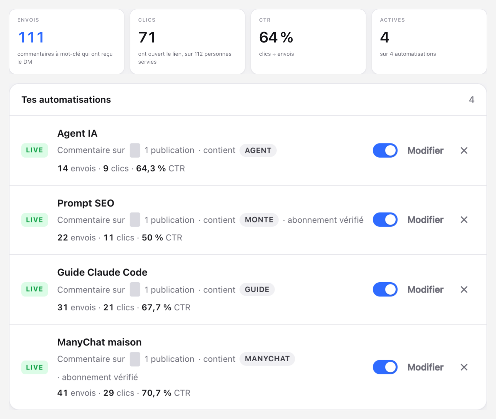
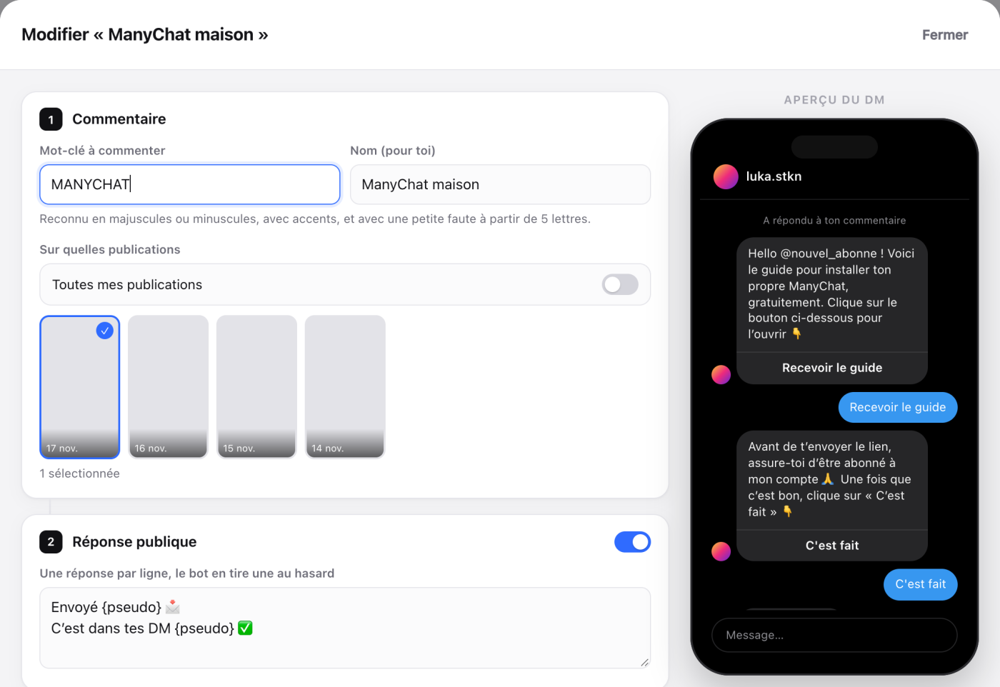

# Ton ManyChat maison : l'auto-DM Instagram gratuit

Quelqu'un commente un mot-clé sous ton reel. Ton bot :

1. lui répond sous son commentaire ;
2. lui envoie un message privé avec un bouton ;
3. vérifie qu'il est abonné, si tu l'as demandé ;
4. lui envoie ton lien quand il clique.

Tu gères tout depuis ton interface : tes automatisations, tes textes, tes publications, et tes chiffres (envois, clics, CTR).



## Pourquoi c'est gratuit

- **L'API Instagram** est l'API officielle de Meta : gratuite.
- **Le bot tourne chez Cloudflare**, sur leur offre gratuite (Workers et base D1). Pas de serveur à louer, pas d'abonnement : l'offre gratuite encaisse des milliers de commentaires par jour.
- **Ton jeton Instagram se renouvelle tout seul** : rien à refaire tous les 60 jours.

Tout ce qui fait tourner le bot (ton compte Cloudflare, ton app Meta, tes données) t'appartient. Ce dépôt ne contient aucun compte ni aucune clé.

## Ce qu'il fait comme ManyChat

| | |
|---|---|
| Mot-clé en commentaire | Reconnu en majuscules ou minuscules, avec accents, emojis, et une petite faute de frappe |
| Réponse publique | Plusieurs réponses possibles, le bot en tire une au hasard |
| DM avec bouton | Ton texte, ton bouton, ton lien |
| Abonnement obligatoire | Option : le lien n'arrive qu'aux personnes abonnées |
| Une seule fois par personne | Option : pas de second DM si la personne recommente |
| Statistiques | Envois, clics sur le lien, CTR, dernières actions en direct |



## L'installer

Il te faut un compte Instagram **professionnel** (Créateur ou Entreprise), **Node.js** sur ton ordinateur, un compte **Cloudflare** gratuit et un compte **Meta for Developers** gratuit. Compte environ 45 minutes la première fois.

**Le guide pas à pas est ici : [GUIDE.md](GUIDE.md).**

Le plus simple : télécharge ce dossier, ouvre-le dans Claude Code (ou ton agent IA préféré) et colle-lui ce message :

> Je veux installer ce bot d'auto-DM Instagram. Lis le GUIDE.md et les fichiers du dossier, puis accompagne-moi étape par étape : lance toi-même les commandes du terminal quand c'est possible, dis-moi exactement où cliquer dans Cloudflare et dans Meta, attends ma confirmation avant chaque étape suivante, et aide-moi si j'ai une erreur. Ne me demande jamais mes mots de passe ni mes jetons : je les colle moi-même quand le terminal les demande.

En résumé, l'installation tient en trois commandes et quelques réglages chez Meta :

```bash
npm install
```

```bash
npm run installer
```

```bash
npm run installer -- --jeton
```

## Ce qu'il y a dans le dossier

| Fichier | À quoi il sert |
|---|---|
| `GUIDE.md` | Le guide d'installation pas à pas |
| `src/bot.js` | Le parcours : commentaire, réponse, DM, abonnement, lien |
| `src/instagram.js` | Les appels à l'API Instagram et le renouvellement du jeton |
| `src/match.js` | La reconnaissance du mot-clé |
| `src/api.js`, `src/admin.html` | Ton interface et son API, protégée par ta clé |
| `src/privacy.js` | La page de confidentialité demandée par Meta |
| `schema.sql` | La base de données |
| `scripts/installer.mjs` | L'installateur |
| `test/simuler.mjs` | Le test de tout le parcours, en mode essai |

---

Projet indépendant, sans lien avec Manychat ni avec Meta. Licence MIT : tu peux l'utiliser, le modifier et le partager librement.
